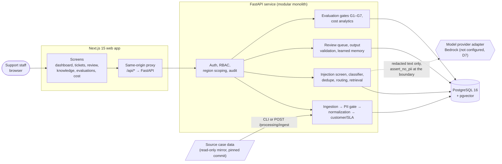
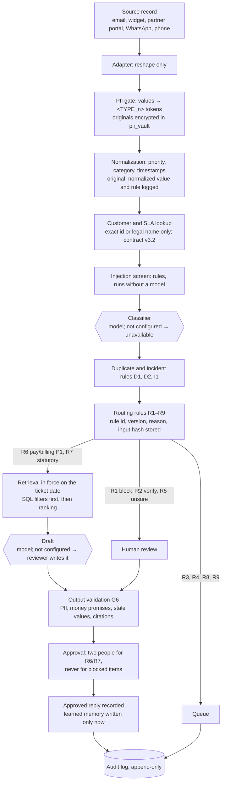
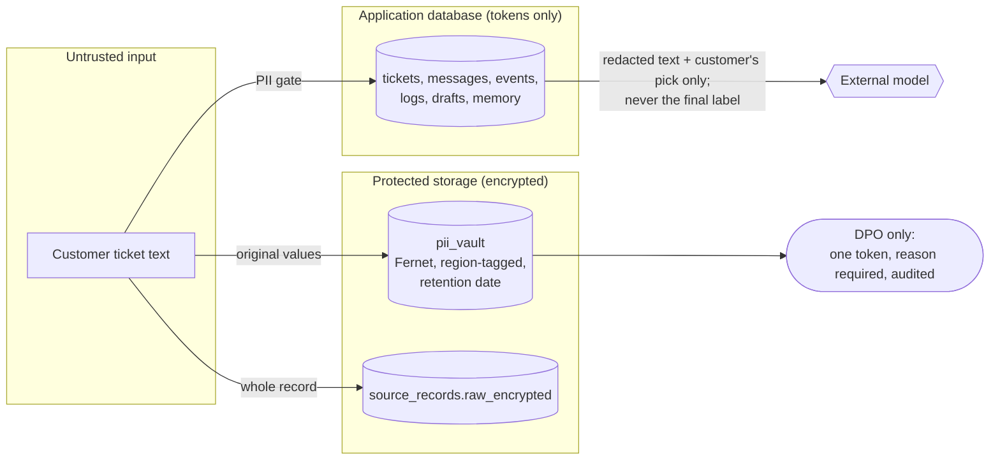

# Architecture overview

This page is the entry point to the architecture. Each stage has its own detailed page:
[data pipeline](data-pipeline.md) · [AI pipeline](ai-pipeline.md) ·
[human approval and security](human-approval-security.md) · [frontend](frontend.md) ·
[database](../database/README.md) · [API](../api/README.md) · [evaluation](../evaluation/README.md).

Diagrams are Mermaid, so they render on GitHub and stay editable as text.

## 1. Components

A modular monolith: one FastAPI service with independently tested service modules, one Next.js web
app, and one PostgreSQL database with pgvector. There is no Redis, Kafka or separate worker fleet,
because nothing measured so far requires them (the deterministic pipeline runs in about 57 ms per
ticket at p95, G7).

| Component | Code | Responsibility |
|---|---|---|
| Web app | `frontend/src/app/(app)/` | Screens backed by live API data; no business logic |
| Proxy | `frontend/src/app/api/[...path]` | Keeps the session cookie first-party; the browser never calls FastAPI directly |
| Auth and access | `backend/app/core/`, `app/api/deps.py`, `app/api/scoping.py` | Argon2id, revocable JWT sessions, permissions in code, region filters on every query |
| Data pipeline | `app/services/{ingestion,pii,normalization,sla}`, `customer_lookup.py` | Source adapters, PII tokenisation and vault, logged normalisation, SLA contract v3.2 |
| AI pipeline | `app/services/{classification,deduplication,routing,knowledge}`, `app/ai/` | Rule-based injection screen, provider-neutral classifier, duplicate and incident rules, routing rules R1–R9, date-aware retrieval |
| Human approval | `app/services/{approvals,validation}` | Evidence packs, the approval state machine, output validation (G6), learned memory |
| Evaluation | `app/services/evaluation/`, `evaluations/` | Gates G1–G7 in rolled-back sessions, the report, the Promptfoo config |
| CLI | `app/cli.py` | `ingest`, `index-knowledge`, `detect-duplicates`, `route-all`, `build-review-queue`, `evaluate`, `create-user` |

## 2. End-to-end ticket flow

The stages follow the master specification. Python makes every deterministic decision; a model may
only classify and draft, and neither is configured yet (D7), so those stages report `unavailable`
and hand the ticket to a person instead of guessing.

## 3. Trust boundaries

- **Ticket text is data, never instructions.** It is wrapped as untrusted content in the prompt, screened
  by rules before any model call, and blocked tickets (R1) cannot be approved.
- **No privileged tools exist.** The platform has no endpoint that moves money, approves refunds or
  changes payroll, so an injected instruction has nothing to call. Drafts that promise these fail
  validation.
- **PII is checked twice** before leaving the process: by the PII gate at ingestion and by
  `assert_no_pii` at the network boundary. G1 measures both.

## 4. Approval state machine

```mermaid
stateDiagram-v2
  [*] --> pending: routing rule R1, R2, R5, R6 or R7
  pending --> pending: edit draft (re-validated)<br/>or reassign queue
  pending --> approved: approve<br/>(draft passes every check;<br/>second person for R6/R7;<br/>never for block)
  pending --> rejected: reject
  pending --> escalated: escalate (L2, L3, Security, DPO)
  pending --> resolved: resolve (note required)
  approved --> [*]
  rejected --> [*]
  escalated --> [*]
  resolved --> [*]
```

The state lives in PostgreSQL (`approvals`, `approval_events`), so a pending item survives restarts.
LangGraph was not adopted: these tables already give pause, resume and an audit trail, and there is no
multi-step drafting agent yet to justify a graph runtime.

## 5. Key design decisions

| Decision | Why | Evidence |
|---|---|---|
| Rules, not the model, route and authorise | The spec forbids model-made routing or approval; rules are reproducible | Every routing decision stores rule id, version and input hash |
| Never use the export's header category as a classifier input | It equals the final corrected queue for all 1,327 routed tickets (label leak) | [Discovery §3](../discovery/README.md) |
| Effective dates derived from rules, never from `last_reviewed` | KB articles carry no effective dates | G5: 0 stale chunks on 48 replayed tickets |
| Similar text alone never merges tickets | 199 same-customer, same-text pairs are *not* duplicates | G3: 0 false merges |
| Full-text retrieval first, embeddings later | No embedding model is available yet (D7); pgvector columns exist | Hindi and Arabic questions match poorly until embeddings exist |
| Source data is fetched, not committed | This repository is public and the upstream has no licence (D6) | `scripts/source_data.py` with SHA-256 manifest |
| Modular monolith, no Redis or Kafka | No measured need; one database keeps transactions simple | G7 deterministic p95 about 57 ms |

## 6. Deployment target (not built)

The AWS stage (Phase 7) is **paused**: no infrastructure code exists and nothing is deployed. The
intended shape and the open prerequisites are in the [deployment guide](../deployment/README.md).
