# Ticket intake, live pipeline and AI management

Added on 20 Nov 2026. A person logs a ticket in the app. It runs through the same rules as the imported
data, and every step is recorded and shown live. The AI provider is OpenRouter (decision D7, see
[Decisions](#decisions)).

## Flow

```mermaid
flowchart LR
  F[New ticket form] --> R[Received<br/>PN-2xxxxx, raw encrypted]
  R --> P[PII gate<br/>tokens + vault]
  P --> N[Normalize]
  N --> C[Customer + SLA]
  C --> D[Duplicates D1/D2/I1]
  D --> I[Injection screen]
  I -->|flagged| RT
  I --> CL[AI classification<br/>OpenRouter]
  CL --> RT[Routing rules R1–R9]
  RT --> RE[Date-aware retrieval]
  RE -->|lane draft_for_agent| DR[AI draft<br/>OpenRouter]
  RE -->|other lanes| RV
  DR --> V[Output validation G6]
  V --> RV[Human review]
```

- **Intake (synchronous).** `POST /api/v1/tickets` runs the first four steps in the request:
  - it gets an id from the `app_ticket_seq` sequence (PN-200001 upward, never clashing with the source data);
  - the PII gate runs before any plain text is stored;
  - priority and category are logged as normalization rules;
  - the customer is resolved, and the SLA clock and credit exposure are computed.

  The ticket is marked `origin = 'app'`.
- **Pipeline (background).** The request returns at once. The other eight steps run as a background task:
  `app/services/pipeline/runner.py`. Each step is committed as it finishes, so the
  flow page (`/tickets/{ref}/flow`) polls `GET /api/v1/pipeline-runs/{id}` and shows progress live.
- **Re-run.** `POST /api/v1/tickets/{ref}/pipeline` runs the post-intake steps again for any ticket, imported or
  app-entered. For an imported ticket, the intake steps report what the batch import stored, and the
  duplicate step reports its existing case membership.
- **Step records.** Every step's status, timing, decision and cost is kept in `pipeline_runs.steps`. A step's
  status is `done`, `review`, `blocked`, `skipped` or `failed`. Records hold identifiers, counts and decisions,
  never ticket text or PII values.

## Safety rules (in code, not in prompts)

| Rule | Where |
|---|---|
| The model never routes. Rules R1–R9 decide the lane, queue, level and approval | `services/routing/engine.py` |
| Drafts are written only in the `draft_for_agent` lane (R6, R7, R8); other lanes get none | `pipeline/runner.py` |
| A ticket flagged by the injection screen is never sent to a model | `pipeline/runner.py` |
| Every outbound payload is checked for PII patterns before the network call | `ai/providers/openrouter.py` → `assert_no_pii` |
| Requests require providers with `data_collection: deny` and zero data retention | `ai/providers/openrouter.py` |
| Budget guard: the daily cap (IST day) and per-ticket cap are checked before every call; when reached, the step is skipped and the ticket goes to a person | `services/ai_config.py` |
| Every AI draft goes through the deterministic validator and then to a person; the AI never approves | `validation/output.py`, `approvals/service.py` |
| Learned memory is still written only from human-approved replies | `approvals/service.py` |

**Two-person rule.** Approvals for R6 and R7 still require that the person approving is not the last person who
edited the draft. An unedited AI draft therefore needs one human approval. If a person edits it, a second
person must approve.

## AI management (`/ai`)

| Tab | Shows |
|---|---|
| Overview | Spend today against the daily cap; spend this month; average cost per ticket and per draft (target ≤ USD 0.02); success rate; p50/p95 latency; tokens; spend and calls per day; a breakdown by model and step; guardrail counts; pipeline runs; the most expensive tickets; a monthly projection |
| Call log | Every model call: time, ticket, step, model, the upstream provider that served it, tokens, latency, cost and outcome |
| Models and limits | The on/off switch, a model per step chosen from OpenRouter's live catalogue, the daily and per-ticket caps, a connection test (one small billed call), privacy settings, and the key's spend as OpenRouter reports it |

**Where the figures come from.**
- Costs are what OpenRouter reports it charged for each call (`usage.cost`, in OpenRouter credits, which are
  US dollars). They are stored in `model_usage` with `cost_source = provider_reported`.
- The only derived figure is the monthly projection: the measured average AI cost per ticket × the Finance
  cost sheet's monthly volume. It is labelled as such, and excludes hosting and search.

**Who can see and change it.**
- `ai:read`: support lead, DPO, finance viewer, admin.
- `ai:manage`: admin only.
- `tickets:create`: every support role and admin.
- Every settings change is audited (`ai_settings.updated`).

## Data model

- `pipeline_runs`: one row per run. Holds the ticket, trigger (`create` or `rerun`), status, the steps
  (JSONB), whether AI was on, total cost, who started it, and timestamps.
- `model_usage`: gains `pipeline_run_id`, `prompt_version`, `cost_source`, `error` (a short code),
  `request_id` and `upstream_provider`. It never stores prompt or response text.
- `tickets.origin`:
  - `import` is the pinned source data (the evaluation set);
  - `app` is tickets logged in the app.
  - G3, G4 and G7 measure imported tickets only. G1 still scans every stored surface, including app-entered tickets.
- Migration: `0007_ticket_intake_ai`. It is reversible.

## Decisions

- **D7 (model access):**
  - Resolved for the synthetic case data with OpenRouter. The project owner approved this on 20 Nov 2026.
  - Masked text leaves India and the UAE. This is acceptable only for synthetic data.
  - Real customer data needs DPO sign-off and an in-region option first, for example Bedrock in the client's AWS account.
  - Bedrock remains supported (`LLM_PROVIDER=bedrock`) for the classifier.
- **Daily cap:** USD 2 by default, changeable in AI management.
- **Model choice:** made in the app from OpenRouter's catalogue. Only models with tool calling and a fixed price are listed.

## Verification status

- **Automated tests** (`backend/tests/test_intake_pipeline.py`) use a fake OpenRouter provider and a mocked
  HTTP transport. No real model is called. They cover:
  - the privacy routing and reported cost parsing;
  - the PII block before any network call;
  - error codes and retry;
  - the catalogue filter;
  - full creation with AI off and on;
  - injection (no model call);
  - the per-ticket cap;
  - the D1 follow-up link;
  - region scope and input rules;
  - re-running on PN-101414.
- **Live OpenRouter run (20 Nov 2026)**, model `anthropic/claude-haiku-5.5` for both steps, served by Amazon
  Bedrock through OpenRouter:
  - **Connection test:** a synthetic how-to question was classified as `how_to` (confidence 0.93) in 2.4 s, at a
    reported cost of USD 0.000292.
  - **Statutory example** (a PF question carrying an Aadhaar and a PAN; the customer had picked "payroll"):
    - the 2 identifiers were tokenized;
    - the model classified it `statutory` (confidence 0.85), and rule R7 routed it to Statutory-Compliance;
    - 4 sources and 2 rates in force were retrieved;
    - the draft (87 words) stated INR 25,000 from 1 Aug 2026 and cited R-IN-PF-2026-08;
    - all 10 validation checks passed, and the item waited for a person.
    - Costs: classification USD 0.000336, draft USD 0.000303, **total USD 0.00064**. The run took 6.6 s end to end.
  - **Injection example:** the injection screen flagged 3 phrases, rule R1 blocked the ticket, no model call was made
    (USD 0.00), and it went to Security-Review.
  - These are single-ticket checks, not an evaluation: G2 (classification accuracy) and G5 faithfulness remain
    *not run* until a labelled evaluation with the model is executed.
- **Provider notes found in the live run:**
  - Some models' endpoints refuse a tool forced by name. The adapter falls back to `required`, then `auto`, and
    accepts JSON returned as plain content.
  - `require_parameters` is not used, because it excluded every endpoint for this model. Only the privacy constraints
    (`data_collection: deny`, `zdr: true`) are sent, and every output is still schema-validated.
