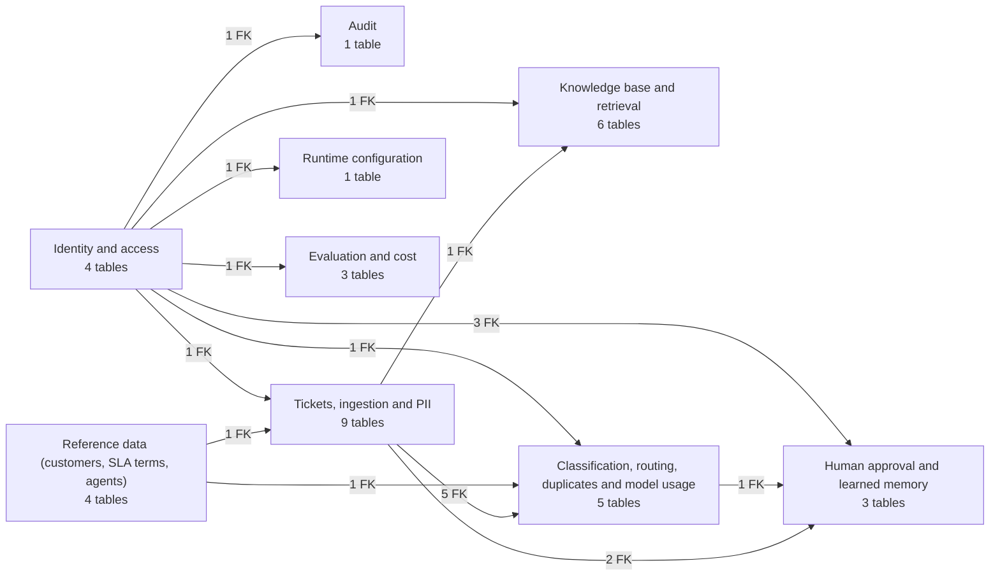
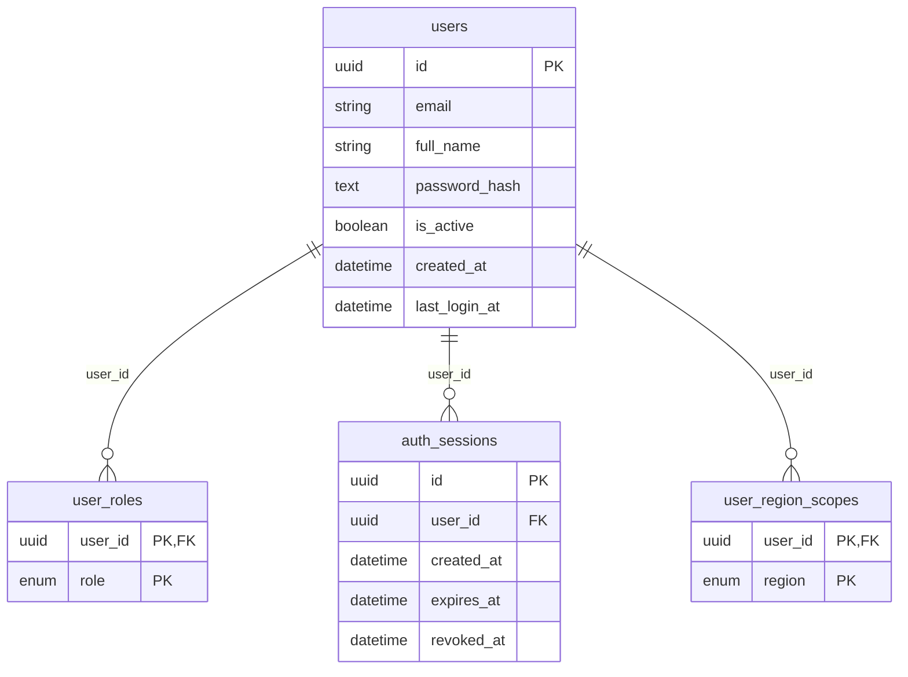
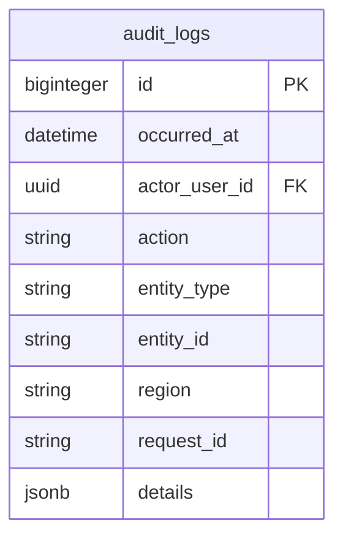
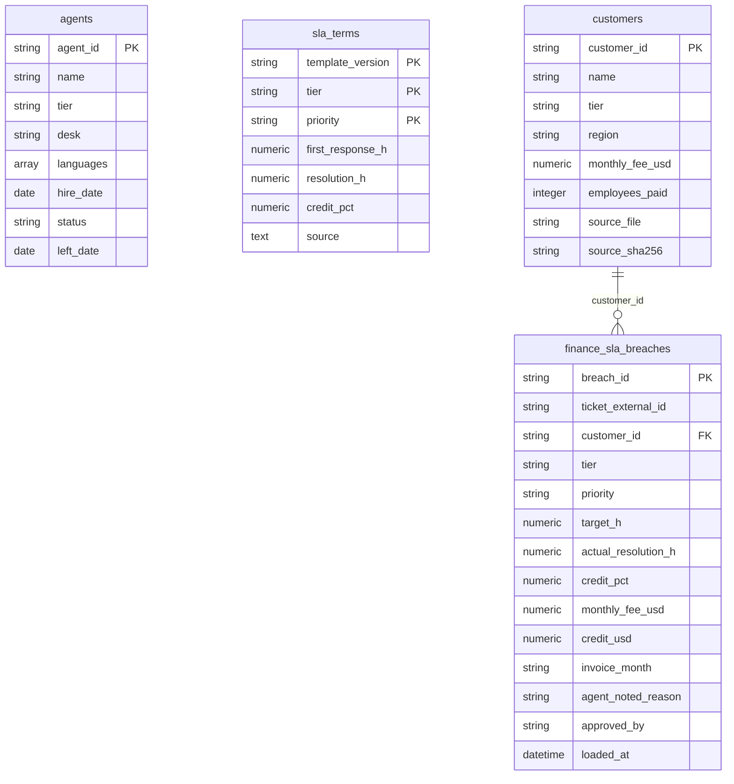
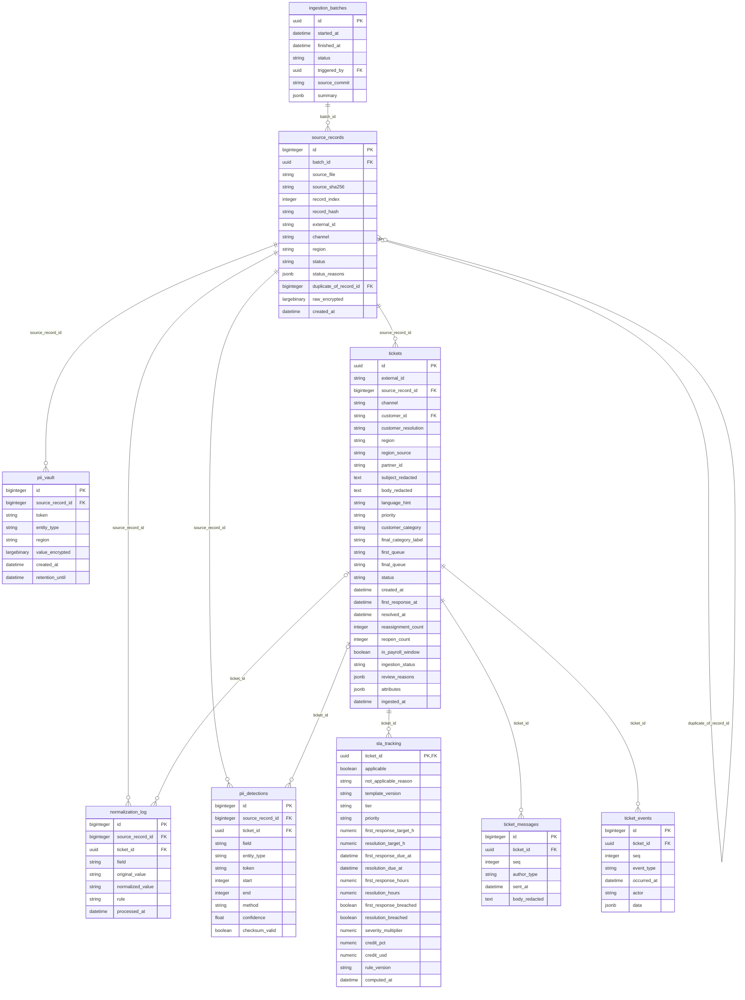
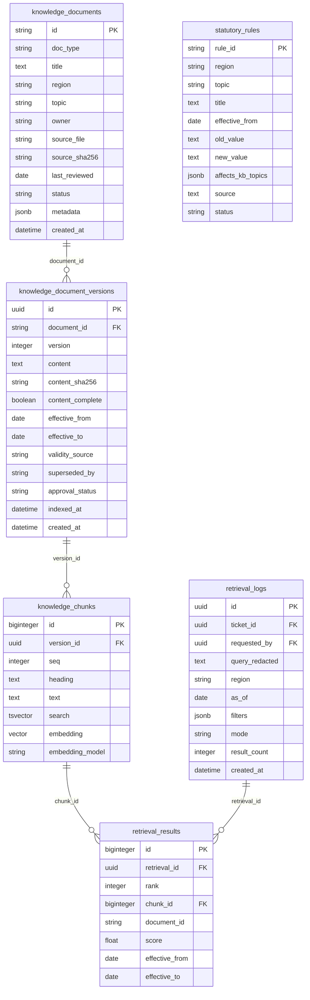
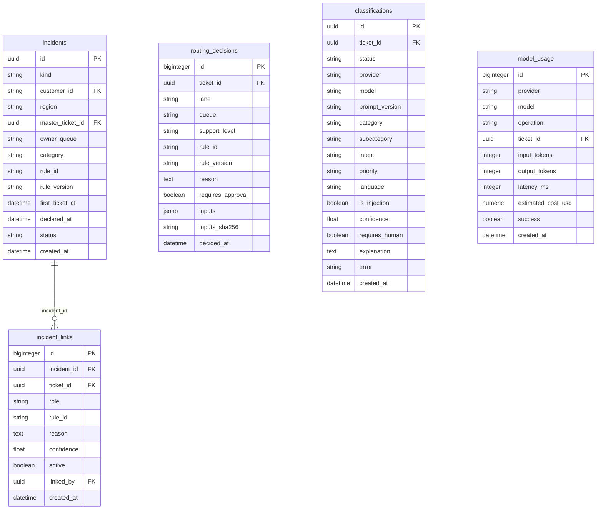
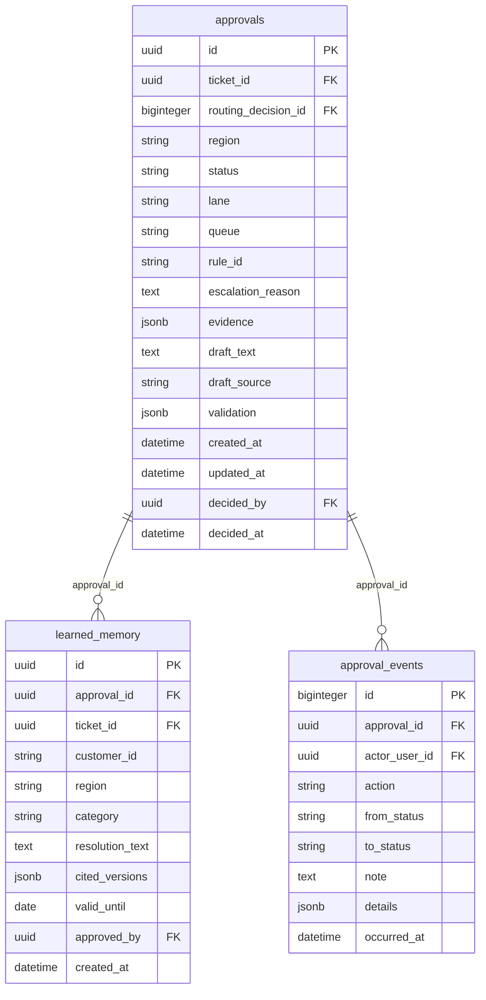
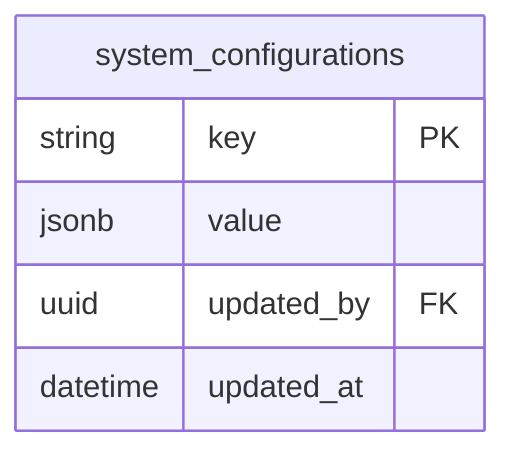
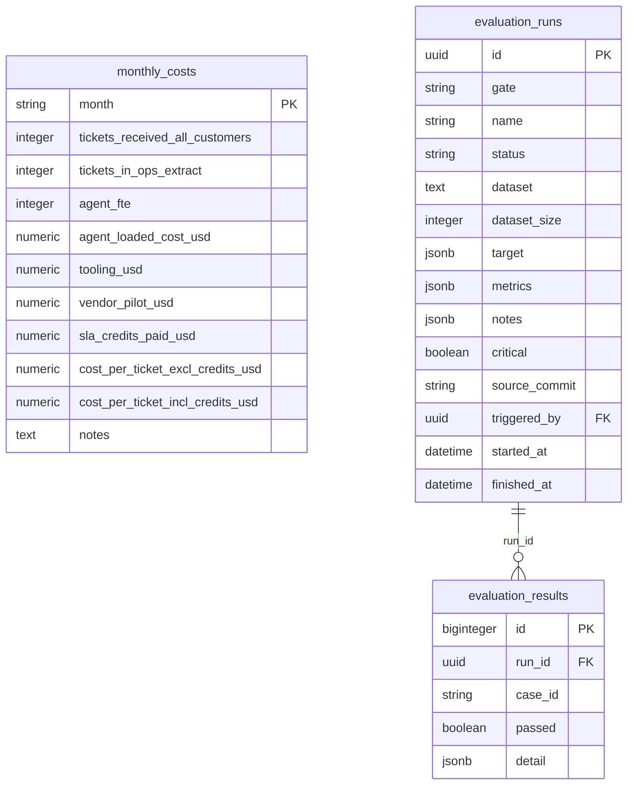

<!-- Generated by scripts/generate_reference_docs.py. Do not edit by hand. -->

# Database

PostgreSQL 16 with pgvector. 36 tables, created only by Alembic migrations
(`backend/alembic/versions/`). Constraint names follow a fixed convention so migrations diff cleanly.

Database-enforced rules worth knowing:

- `audit_logs` is append-only: a trigger rejects `UPDATE` and `DELETE`.
- PII originals live only in `pii_vault` (Fernet-encrypted, region-tagged, with a retention date);
  `source_records.raw_encrypted` holds the encrypted original record. Ticket subjects, bodies, messages,
  events, logs and drafts hold `<TYPE_n>` tokens only.
- Check constraints restrict regions (`IN`, `UAE`), priorities, statuses and effective-date windows.

## Domains

Arrows point from the referenced domain to the referencing one.

## Identity and access

## Audit

References to other domains: `audit_logs.actor_user_id` → `users`.

## Reference data (customers, SLA terms, agents)

## Tickets, ingestion and PII

References to other domains: `ingestion_batches.triggered_by` → `users`, `tickets.customer_id` → `customers`.

## Knowledge base and retrieval

References to other domains: `retrieval_logs.requested_by` → `users`, `retrieval_logs.ticket_id` → `tickets`.

## Classification, routing, duplicates and model usage

References to other domains: `incident_links.linked_by` → `users`, `incident_links.ticket_id` → `tickets`, `incidents.customer_id` → `customers`, `incidents.master_ticket_id` → `tickets`, `routing_decisions.ticket_id` → `tickets`, `classifications.ticket_id` → `tickets`, `model_usage.ticket_id` → `tickets`.

## Human approval and learned memory

References to other domains: `learned_memory.approved_by` → `users`, `learned_memory.ticket_id` → `tickets`, `approvals.decided_by` → `users`, `approvals.routing_decision_id` → `routing_decisions`, `approvals.ticket_id` → `tickets`, `approval_events.actor_user_id` → `users`.

## Runtime configuration

References to other domains: `system_configurations.updated_by` → `users`.

## Evaluation and cost

References to other domains: `evaluation_runs.triggered_by` → `users`.
